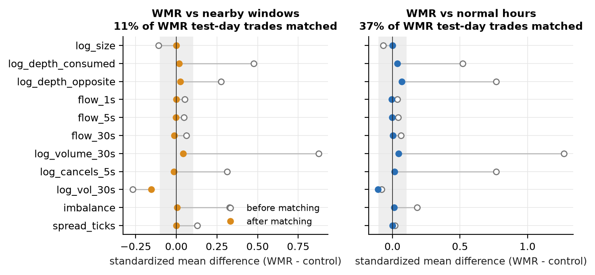
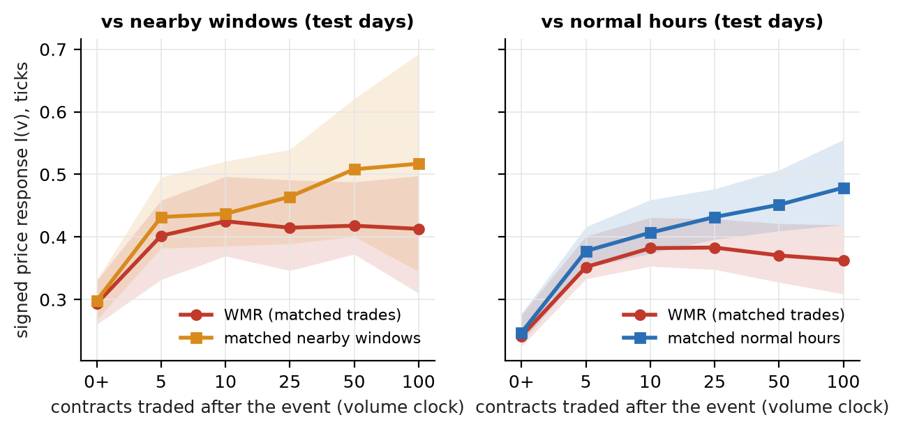
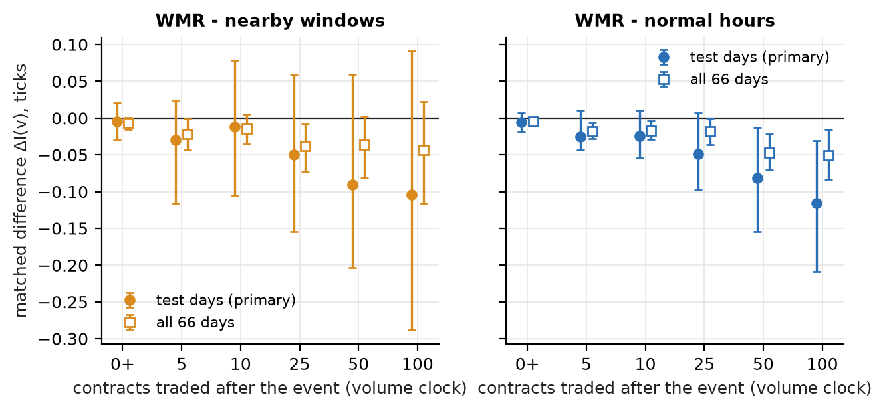
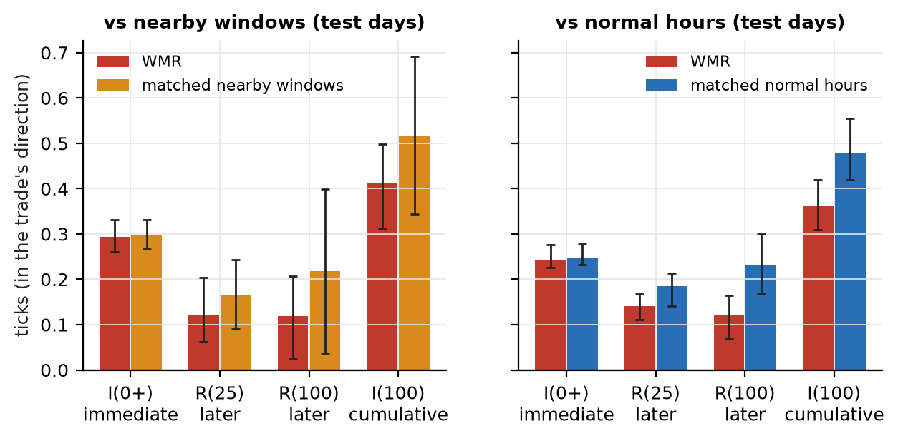
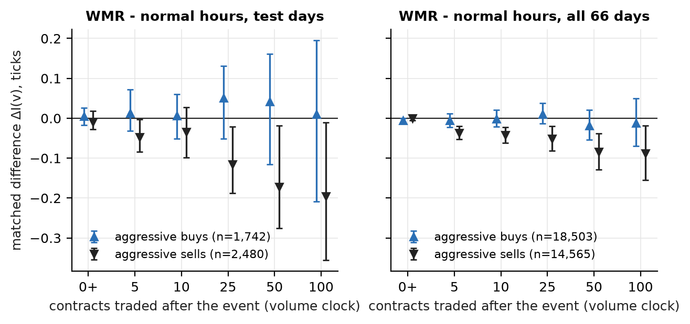
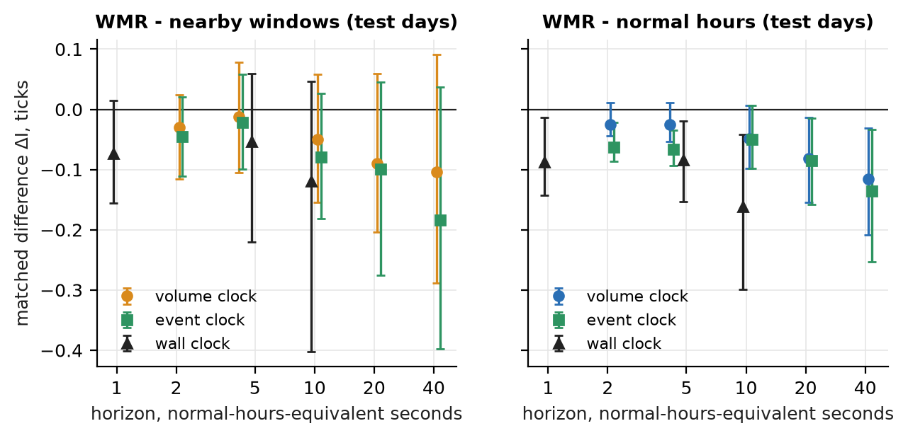
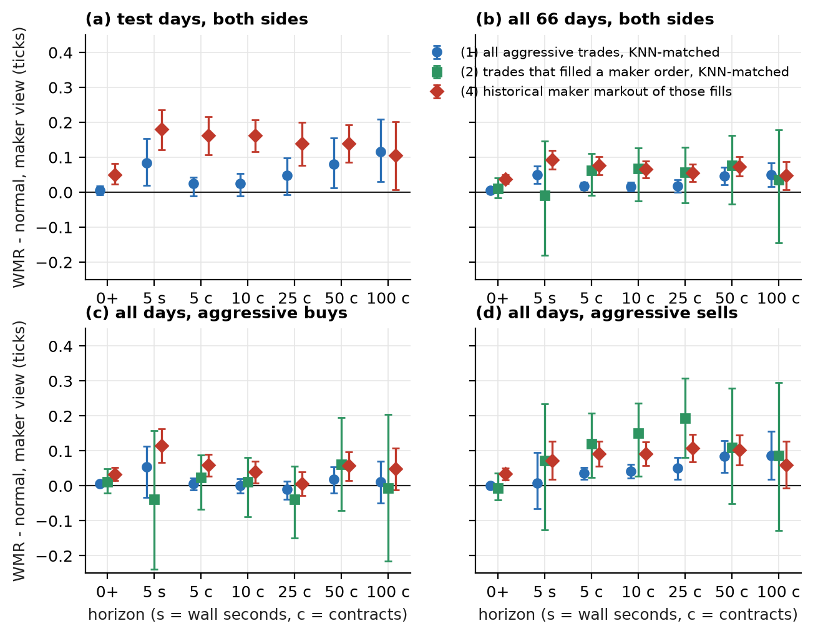

# KNN-matched price impact of aggressive trades around the WMR fix (CME 6E)

Code: `wmr_price_impact/` (`build_trade_events.py`, `matching.py`, `analyze_results.py`, `plots.py`, `tests/`).
Tables: `outputs/wmr_price_impact/tables/`. Figures: `outputs/wmr_price_impact/figures/`.
Run from `project/`: `python -m wmr_price_impact.build_trade_events`, then `analyze_results`, then `plots`; tests with `pytest wmr_price_impact/tests`.

## Answer in brief

**Question.** Does WMR's better maker markout reflect a general reduction in directional price impact after comparable aggressive trades? Or is it mostly confined to the historical passive orders that get filled?

**Answer: partly the first, mostly at longer horizons, and not through immediate impact.**

- **Immediate impact is the same.** Comparable aggressive trades move the mid by the same amount at WMR as in normal hours: −0.006 tick, 95% CI [−0.019, +0.007], test days.
  - Without matching, WMR's immediate impact is 0.09 tick smaller.
  - That gap is fully explained by the pre-trade book: WMR trades meet deeper queues, so fewer of them clear the level.
- **What differs is the subsequent drift in the trade's direction.** It is smaller at WMR, and the gap grows with the horizon:
  - −0.05 tick after 25 further contracts (p = 0.08);
  - −0.08 after 50 (p = 0.03);
  - −0.12 after 100 (p = 0.01).
  - These are test days, WMR vs matched normal-hours trades. The gap holds across K, caliper, clock and boundary checks. Over all 66 days it is about half as large (−0.05).
  - WMR prices still drift in the trade's direction, by about half as much. This is less continuation, not a reversal.
  - The effect comes from aggressive sells; aggressive buys show none.
- **At the horizons where the maker advantage was measured, the general effect is a minority share** (all 66 days):
  - the matched all-trade impact difference is about a quarter of the historical maker-markout advantage at 10 contracts, and about half at 5 s;
  - only at 100 contracts are the two the same size.
  - Trades that actually filled a historical maker order show a WMR advantage about 3× the all-trade figure after matching, but that estimate is imprecise.

So the maker advantage combines two things:
- a general, horizon-growing reduction in continuation after comparable trades;
- a component concentrated in the trades that fill the historical passive orders.

Findings A (smaller immediate impact) and E (poor support) apply only partly. Finding D (state explains the raw difference) holds fully for immediate impact. This report does not identify trader motives.

## 1. Research question and hypotheses

Phase 3 found that WMR passive fills have 0.08–0.10 tick better 5-second maker markouts than normal hours. The advantage survives volume- and event-clock horizons and book-state matching. Spread capture is identical; the advantage comes from smaller adverse mid moves after the fill. For a passive fill against an aggressor of sign q, with s = −q:

**maker markout M(h) = spread capture − signed aggressive impact I(h)**, exactly, at the execution level.

Here we study the right-hand term on **all** aggressive trades. The hypotheses:

- **H1 – lower immediate impact:** I_WMR(0+) < I_normal(0+).
- **H2 – similar immediate impact, weaker subsequent response:** I(0+) is equal, and R(v) = I(v) − I(0+) is lower at WMR.
- **H3 – historical maker-order selection:** aggregate responses are similar, but the trades that fill the historical maker orders differ.

## 2. Literature

| Source | What we checked | What we take | Relationship |
|---|---|---|---|
| Cont, Kukanov & Stoikov (2014), *The Price Impact of Order Book Events*, J. Financial Econometrics 12(1):47–88 | Read the arXiv abstract (1011.6402). Over short intervals, price changes are mainly driven by order-flow imbalance at the best quotes, with a slope inversely proportional to market depth. Data: NYSE TAQ, 50 US stocks. | Price response must be conditioned on depth and recent flow. That is why depth and signed flow are matching features. | **Adaptation of the conditioning idea.** We do not estimate an OFI regression. |
| Krohn, Mueller & Whelan (2024), *Foreign Exchange Fixings and Returns around the Clock*, J. Finance 79(1):541–578 | The journal page was not accessible (HTTP 403). The working-paper abstract was read in Phase 3: intraday drifts reverse strongly at the major fixes, attributed to order imbalances and dealer inventory. | Motivation that fix-related flow may produce temporary price pressure. | **Motivation only.** Different market (spot FX), horizon (hours vs seconds) and identification. |
| Muhle-Karbe, Oomen & Weber (2025), *Hedging of Fixing Exposure*, Mathematical Finance | The publisher page was not accessible (HTTP 403). We rely on its stated scope only: dealers' hedging of fixing exposure under price impact. | Motivation for separating the immediate response from the later response. | **Conceptual motivation only.** We make no claim about its model or results. |
| Albers, Cucuringu, Howison & Shestopaloff (2025), *The Market Maker's Dilemma*, arXiv 2502.18625 | Read the abstract. In a live experiment on the Binance BTC perpetual, maker fill likelihood and post-fill returns are negatively correlated. | Observed maker outcomes depend on which orders get filled. Hence the all-trade sample and the bridge in Section 7. | **Motivation.** Different market; no replication. |

What is established here comes only from our data: Sections 5–7 and their tables. Mechanism words such as "temporary pressure" or "inventory" are not identified by this design.

## 3. Trade events and quality checks

**Event = one exchange packet containing at least one non-snapshot `T` row.**
- All rows of a packet share `ts_event` and end at `is_last`.
- The `T` (trade summary), `F` (passive fills) and follow-up `C`/`M` (book updates) rows of one match are never counted separately.
- A packet sweeping several levels, or occasionally holding several aggressor order ids, is one event. The packet is the finest unit with an observable book state before and after.
- **Size** = sum of `T` sizes (the executed quantity, the same units as the verified Phase 3 volume clock).
- **Aggressor side q:** +1 if every `T` row is B, −1 if every `T` row is A, otherwise **ambiguous**.
  - An N-side `T` (aggressor not identified) makes the event ambiguous.
  - An earlier, looser rule took q from the side-known rows only. It mislabelled a packet in which N-side rows swept the bid for 13 lots alongside two 1-lot B-side rows. A unit test caught this.

**Pre-trade state** = end of the previous packet.
- It is computed by the existing, unit-tested `wmr_value.build_labels.entry_features`, with the consumed side as the order side.
- "Consumed depth" is the best-level depth the trade hits. "Opposite depth" is the other side.
- Signed flow = recent aggressive volume in the trade's direction.

**Responses** are in ticks, positive in the trade's direction.
- m− = mid at the previous packet end; m+ = mid at the event-packet end.
- Volume horizon v: mid at the last packet whose cumulative traded volume is ≤ the event-end volume + v. This is the same convention as `wmr_value/clocks.py`.
- Grid: v ∈ {5, 10, 25, 50, 100} contracts.
  - It was fixed from training days: the median event is 2 lots, p90 about 10, and the normal-hours rate is 2.42 contracts/s.
  - Median wall duration of the 100-contract horizon: WMR 8.1 s, nearby 12.7 s, normal 30.0 s.
- The event clock uses the existing `cum_clocks` (non-snapshot A/C/M/T/F messages), scaled to the same normal-hours duration. The wall clock uses 1, 5 and 10 s.
- A horizon is dropped if it runs past the file end, meets a book reset, or takes more than 300 s. Coverage is ≥ 99.8% for every horizon and period.

**Sample:** London 08:00–17:00 on weekdays, 66 days, with the chronological split from Phase 3:

| Split | Dates | Days |
|---|---|---|
| train | 07-14 to 09-07 | 40 |
| validation | 09-08 to 09-24 | 13 |
| test | 09-25 to 10-13 | 13 |

| Events kept | WMR | nearby | normal |
|---|---|---|---|
| all days | 55,336 | 44,058 | 1,147,452 |
| test days (buys / sells) | 4,694 / 6,689 | 4,870 / 4,824 | 151,052 / 149,009 |

Per-day counts by side are in `sample_sizes_by_day.csv`. The smallest is 84 WMR sell events on one day.

**Exclusions and checks** (`exclusions.csv`, `tests/test_price_impact.py`, 7 tests, all passing):
- **Ambiguous side:** 3.0% of WMR events, 1.4% nearby, 1.7% normal. Invalid pre-trade book, reset in the packet, or missing post-trade mid: 0%.
- **Double counting:** one row per packet. The sum of event sizes equals the day's `T` volume. Passive `F` quantity (excluding an aggressor's own `F`) equals the `T` size in 99.2–99.4% of events.
- **Aggressor sign:** buyer `T` prices ≥ pre-trade ask and seller `T` prices ≤ pre-trade bid in > 99% of events. I(0+) ≥ 0 in > 99.9%.
- **Mids:** m− equals the recomputed previous-packet mid. All responses lie on half-ticks.
- **Volume horizons:** the horizon packet is the last packet within v, and the next packet crosses v. Responses are recomputed by hand for 200 events.
- **No look-ahead:** scrambling every message after the event packet (prices, sides, sizes, ids, book) leaves the feature vector unchanged.
- **Maker link:** each Phase 3 maker fill is linked by order id to the packet of its first own-price `F`.
  - 97.6% of the 183,066 fills fall in a kept event; the rest are ambiguous-side events.
  - In every linked fill the maker side is opposite the aggressor.
  - The maker's 5 s markout equals spread capture − I(5 s) exactly, to 1e-9.
- **Matching universe:** controls come only from the intended period and the same strata, distances are within the caliper, and weights sum to 1.

## 4. Matching design, balance and common support

**Features (distance).** Standardized with training-day mean and SD:
- log size; log(1 + consumed depth); log(1 + opposite depth);
- signed flow over 1, 5 and 30 s (sign · log(1 + |x|));
- log(1 + traded volume, 30 s); log(1 + non-fill cancels, 5 s); log(1 + realized mid volatility, 30 s).

No feature exceeded the |corr| > 0.9 drop rule on training days (maximum 0.76). Imbalance and spread are balance diagnostics only, because imbalance is a function of the two depths.

**Strata (exact).** Aggressor side × spread category (1 tick / wider) × decile of recent trade intensity. The decile cutpoints are those of training-day WMR trades.

**Matching rule.**
- Controls are pooled over the days of the evaluated split.
- K = 5 nearest controls, with replacement, kept only within the caliper, each weighted 1/m.
- **Caliper rule** (training days): the largest caliper at which every |SMD| ≤ 0.10 in both comparisons. This selected **0.75**.
- K = 1, K = 10 and caliper 1.0 are robustness checks.

**Design revision, disclosed.** The first frozen design matched within the same day. On training-day features it could not balance trade intensity at any useful coverage:
- SMD of log volume_30s was 0.24–0.69 at calipers 1–3;
- under the balance rule it matched only 0.4–2% of WMR trades.

We switched to the pooled, intensity-strata design using training-day features only. The first run had also written response tables; they were not opened before the revision and were overwritten. Validation days were used only for balance checks.

**Inference.** The trading day is the unit.
- Estimates are means of per-day means.
- CIs and p-values come from a two-sided day bootstrap (2,000 draws, seed 0). Each draw resamples the split's days and applies them both to WMR trades and to their matched controls, so reuse of controls across days is resampled too.
- Unmatched same-day comparisons use the Phase 3 day bootstrap with sign-flip tests.
- No multiple-testing correction is applied across the 6 horizons. The pattern over horizons is more informative than any single p-value.

| Test days, K = 5, caliper 0.75 | vs nearby (A) | vs normal (B) |
|---|---|---|
| WMR trades matched | 1,259 / 11,383 (11%) | 4,222 / 11,383 (37%) |
| …all 66 days (supplementary) | 26% | 60% |
| distance median / p90 | 0.66 / 0.73 | 0.62 / 0.73 |
| unique controls / control slots | 1,315 / 2,121 | 9,156 / 12,242 |
| largest share of weight on one control | 0.7% | 0.2% |
| weight on same-day controls | 14% | 10% |
| max \|SMD\| after matching | 0.15 (volatility) | 0.11 (volatility) |

**Figure 1.** Before matching, WMR trades meet much deeper books (consumed depth SMD +0.5, opposite +0.3 to +0.8), far more recent trading (+0.9 to +1.3) and more cancellation. After matching, every feature is within ±0.07 except 30 s volatility (−0.15 vs nearby, −0.11 vs normal). Validation-day balance is similar; its worst value is opposite depth, 0.13 and 0.15.

**Common support is limited (Finding E, partly).**
- Matched fractions fall with intensity. Vs normal: 85% in the lowest WMR intensity decile, 13% in the highest. Vs nearby: 32% down to 3%.
- They also fall with size. Vs normal: 43% for 1-lot trades, 14% for 25+ lots.
- The nearby windows rarely contain states as busy as WMR.
- **The matched results describe the less intense, smaller-trade part of WMR.** They should not be extrapolated to the busiest WMR seconds.

## 5. Matched price-response curves (volume clock, primary)

| Test days | WMR / matched normal | Δ vs normal [95% CI], p | days < 0 | Δ vs nearby [95% CI], p | Unmatched Δ vs normal (same day) |
|---|---|---|---|---|---|
| I(0+) | 0.242 / 0.247 | −0.006 [−0.019, +0.007], 0.37 | 69% | −0.005 [−0.030, +0.020], 0.66 | −0.086 [−0.098, −0.074] |
| I(5) | 0.352 / 0.378 | −0.026 [−0.044, +0.011], 0.17 | 77% | −0.030 [−0.116, +0.024], 0.25 | −0.173 |
| I(10) | 0.382 / 0.407 | −0.025 [−0.054, +0.011], 0.17 | 77% | −0.012 [−0.105, +0.079], 0.76 | −0.174 |
| I(25) | 0.383 / 0.432 | −0.049 [−0.098, +0.007], 0.08 | 77% | −0.049 [−0.154, +0.058], 0.33 | −0.177 |
| I(50) | 0.370 / 0.452 | **−0.081 [−0.155, −0.013], 0.03** | 85% | −0.090 [−0.203, +0.059], 0.23 | −0.180 |
| I(100) | 0.363 / 0.479 | **−0.116 [−0.209, −0.031], 0.01** | 85% | −0.104 [−0.289, +0.091], 0.29 | −0.173 |
| all 66 days, I(25) / I(100) vs normal | | −0.019 (p = 0.045) / −0.051 (p = 0.003) | | −0.038 (p = 0.02) / −0.044 (p = 0.17) | |

**Figure 2.** Matched WMR and control trades start at the same immediate impact. The normal-hours curve keeps rising to 0.48 tick by 100 contracts, while the WMR curve flattens at about 0.37. The nearby curves show the same shape with wider bands, because only 11% of WMR trades are matched.

**Figure 3.** ΔI(v) is about zero at 0+ and becomes more negative with the horizon. On test days, vs normal hours, it is significant from 50 contracts. Over all days it is smaller (about −0.02 to −0.05) but significant at every horizon. The nearby comparison has the same sign, but its CI includes zero at most horizons.

**Matching removes most of the raw difference (Finding D).**
- Unmatched, WMR trades move the price 0.17–0.18 tick less at every horizon, and 0.09 less immediately.
- After matching, the immediate gap is gone, and only 0.03–0.12 of the later gap remains.

## 6. Immediate impact vs subsequent response

| Test days, vs normal | WMR | matched normal | Δ [95% CI], p |
|---|---|---|---|
| immediate I(0+) | 0.242 | 0.247 | −0.006 [−0.019, +0.007], 0.37 |
| share of trades that move the mid immediately | 42.4% | 44.0% | −1.6 pts, p = 0.03 (unmatched: −15.8 pts) |
| subsequent R(25) | 0.141 | 0.185 | −0.043 [−0.088, +0.013], 0.13 |
| subsequent R(100) | 0.121 | 0.232 | **−0.110 [−0.203, −0.021], 0.02** |
| cumulative I(100) | 0.363 | 0.479 | **−0.116 [−0.209, −0.031], 0.01** |

**Figure 4.** Almost all of the cumulative difference is in the subsequent response.

- **H1 (smaller immediate impact): not supported after matching.** The raw WMR advantage in immediate impact, and in how often a trade clears the level, is explained by observable depth. That is consistent with deeper effective liquidity at the fix, which is itself observable.
- **H2: supported in a specific form.** Immediate impact is the same. Afterwards the price keeps moving in the trade's direction at WMR (R stays positive at about 0.12–0.14), but about half as much as after comparable normal-hours trades.
  - This is *less continuation*, not faster reversal; no matched WMR horizon shows a reversal (R < 0).
  - A 100-contract horizon is not "permanent" impact.

**Side asymmetry (Figure 5).** The effect comes from **aggressive sells**:
- test days: −0.115 at 25 contracts (p = 0.02), −0.196 at 100 (p = 0.04);
- all days: −0.051 at 25 (p = 0.001), −0.087 at 100 (p = 0.004).
- Aggressive buys show none: all days −0.012 at 100 (p = 0.73).

WMR's own sell/buy mix also varies by period: test days have 6,689 sells and 4,694 buys; training days 13,927 and 21,648. We do not interpret the asymmetry beyond reporting it.

**Robustness** (test days, vs normal; Δ at 50 / 100 contracts):

| Variant | Δ at 50 contracts (p) | Δ at 100 contracts (p) |
|---|---|---|
| main (K = 5, caliper 0.75) | −0.081 (0.03) | −0.116 (0.01) |
| K = 1 | −0.082 (0.05) | −0.122 (0.03) |
| K = 10 | −0.074 (0.04) | −0.109 (0.01) |
| caliper 1.0 (66% matched, max \|SMD\| ≈ 0.12) | −0.064 (0.01) | −0.071 (0.03) |
| drop WMR trades in the last 30 s of the window | −0.094 (0.03) | −0.122 (0.008) |
| event clock, same normal-hours duration | −0.085 (0.02) | −0.135 (0.009) |

On the wall clock, Δ is −0.088 at 1 s, −0.084 at 5 s and −0.161 at 10 s (p = 0.02, 0.02, 0.01). The three clocks are different economic horizons: one WMR wall second contains about 5× the normal volume. For the nearby comparison, every variant has the same sign with CIs that include zero (see `effects.csv`).

**Figure 7.** On the volume and event clocks, ΔI grows with the normal-hours-equivalent horizon, and the two clocks agree. The wall clock gives a larger difference at the same nominal duration, because WMR wall seconds contain more trading.

## 7. Link to the maker-markout advantage

All rows are WMR minus normal, from the maker's side: +x means WMR is better for the passive side by x ticks.

| Quantity | 5 s wall | 10 contracts | 25 contracts | 100 contracts |
|---|---|---|---|---|
| **All 66 days, both sides** | | | | |
| (1) all aggressive trades, KNN-matched (n = 33,068 WMR) | +0.049 [+0.026, +0.074] | +0.017 [+0.003, +0.029] | +0.019 [+0.001, +0.036] | +0.051 [+0.015, +0.083] |
| (2) trades that filled a Phase 3 maker order, KNN-matched among linked trades (n = 1,350) | −0.009 [−0.18, +0.15] | +0.067 [−0.026, +0.126] | +0.057 [−0.030, +0.129] | +0.035 [−0.14, +0.18] |
| (4) historical maker markout of the linked fills, unmatched (n = 4,478 WMR fills) | **+0.092** [+0.066, +0.119] | **+0.066** [+0.042, +0.089] | **+0.055** [+0.030, +0.081] | +0.048 [+0.008, +0.087] |
| (5) spread capture difference | −0.007 | −0.007 | −0.007 | −0.007 |
| **Test days, both sides** | | | | |
| (1) all trades, matched | +0.084 [+0.019, +0.153] | +0.025 [−0.011, +0.054] | +0.049 [−0.007, +0.098] | +0.116 [+0.031, +0.209] |
| (4) historical maker markout (n = 928) | +0.180 [+0.122, +0.236] | +0.162 [+0.116, +0.206] | +0.140 [+0.076, +0.199] | +0.106 [+0.007, +0.202] |

Row (3) of `bridge.csv` (linked trades, fill-weighted, unmatched −ΔI) equals (4) − (5) by the identity, so it is omitted here. On test days, (2) has only 157 matched trades and is not informative (CIs about ±0.7), so it is not shown.

**Figure 6.**

**Reproduction.** Over all days, the historical 5 s maker advantage here is +0.092, which reproduces Phase 3's +0.099. The small gap comes from the 2.4% of fills in ambiguous-side events and from assigning the period by trade time. Spread capture differs by only −0.007, so the maker advantage is entirely the impact difference on the trades that hit those orders. On test days the maker advantage is larger (+0.16 to +0.18), so the period matters.

**How much of the maker advantage does the general mechanism explain?** Row (1) over row (4):
- about **half at 5 s** (0.049 / 0.092, all days; 0.084 / 0.180 on test days);
- about **a quarter to a third at 10–25 contracts** (0.017–0.019 vs 0.055–0.066);
- **all of it at 100 contracts** (0.051 vs 0.048).

The general reduction in continuation builds up over the horizon. The maker advantage is already largest at short horizons.

**Selection (H3).** The like-for-like comparison (2) matches maker-linked trades with the same procedure. Its point estimate (+0.06 to +0.07 at 10–25 contracts) is about 3× the all-trade value and close to the maker figure, but its CIs include zero.
- **Aggressive sells (bid makers):** (2) is +0.150 [+0.027, +0.236] at 10 contracts and +0.194 [+0.082, +0.309] at 25. All trades show +0.042 and +0.051, the maker markout +0.091 and +0.107.
- **Aggressive buys (ask makers):** the all-trade difference is about zero at every volume horizon (−0.011 to +0.012). The maker advantage is +0.040 at 10 contracts (p = 0.02), +0.006 at 25 (not significant) and +0.116 at 5 s wall.

These differences between the all-trade population and the trades that filled historical maker orders are a **sample-selection pattern**. It is consistent with participants' order placement, cancellation and survival shaping which trades fill them. It is not evidence about any trader's motive.

## 8. Robustness summary and limitations

**Robust (vs normal hours):**
- immediate impact is the same after matching;
- the subsequent response is smaller at WMR, and the gap grows with the horizon;
- this holds across K = 1/5/10, caliper 0.75/1.0, volume/event/wall clocks, and with boundary trades dropped;
- it holds on test days, on all days at about half the magnitude, and on at least 77% of test days from 5 contracts on.

**Not established:**
- the nearby comparison: same sign, but significant only at a few all-days horizons (e.g. −0.038 at 25 contracts, p = 0.02);
- the maker-linked matched estimate (2) in pooled form;
- any mechanism: replenishment, inventory, benchmark execution.

**Limitations:**
- **Common support.** Only 37% (normal) and 11% (nearby) of WMR test-day trades have comparable controls. The busiest WMR states and the largest trades are under-represented. Balance on 30 s volatility is −0.11 to −0.15.
- **Pooled controls.** Controls are pooled across the days of a split. Day-level conditions are handled only through features and intensity strata. Same-day matching was infeasible (Section 4).
- **Event definition.** A packet is one event. The 0.15–0.5% of packets with several aggressor ids cannot be separated, because no intermediate book state is observed.
- **Ambiguous sides.** N-side events are excluded: 3.0% of WMR events and 2.4% of maker fills.
- **Responses include later flow.** Volume time fixes the amount of later trading but not its direction or information. The responses therefore include the market's subsequent order flow, which is part of the mechanism, not a control.
- **Sample size.** 13 test days. Many horizons and variants are reported without multiplicity correction.
- **Period dependence.** The test-day maker advantage and the sell/buy mix differ from the training period.

## 9. Economic interpretation

**H1 (smaller immediate impact).** The raw data say yes: WMR trades clear the level less often and move the mid 0.09 tick less immediately. But this is fully accounted for by the observable deeper book at the fix, so it is not a WMR effect beyond the book state.

**H2 (weaker subsequent response).** For comparable trades, immediate impact is identical, and the later drift in the trade's direction is weaker at WMR: −0.05 to −0.12 tick over 25–100 contracts on test days, about half that over all days. That is less persistent directional pressure. It is not a reversal, and over these horizons we cannot call either component permanent. It is concentrated in aggressive sells.

**H3 (maker-order selection).** At the horizons where the maker advantage is measured (5 s, or about 10–25 contracts), the general reduction explains about a quarter to a half of the 0.06–0.09 tick maker advantage (all days). Trades that filled the historical maker orders show a larger matched WMR advantage, though imprecisely, and on aggressive buys the general effect is absent while the maker advantage is not.

**Overall.** WMR's better maker markout is not mainly a general reduction in the price impact of comparable aggressive trades. The immediate component is fully explained by the deeper book. A smaller later response is real and grows with the horizon, but at the short horizons where the maker advantage sits it covers only a minority of it. The remainder is concentrated in the trades that fill the historical passive orders, which points to selection in which orders are resting and get filled. It does not point to a market-wide change in impact.
